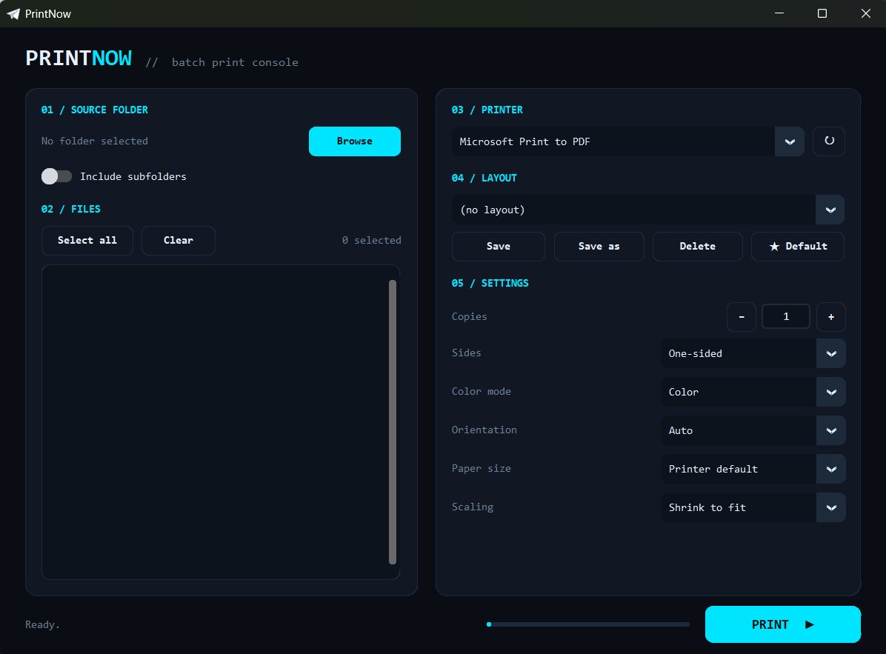

# PrintNow

## Why?
You may ask only because I had a lot of PDF files to print and didn't want to open and print each one manually because I am lazy, so I built PrintNow to automate the job.

A minimal, futuristic-looking batch printing tool for Windows. Pick a folder, tick the files you want, choose a printer and a layout, and send everything to print in one click.


## Features

- **Folder browser**: list all PDFs and images in a folder (optionally including subfolders)
- **Multi-select**: tick individual files or use *Select all* / *Clear*
- **Page counts**: see how many pages each selected file has, plus a total for the selection
- **Printer selection**: choose any installed printer; the system default is preselected
- **Print settings**: copies, one-sided or two-sided (long / short edge), color or black & white, orientation, paper size (A3, A4, A5, Letter, Legal) and scaling
- **Saved layouts**: save your favorite print settings under a name and mark one as the default, so it is loaded automatically on startup
- **Live status**: every file shows *Queued*, *Printing...*, *Done ✓* or *Failed ✗*
- **Supported files**: `.pdf`, `.png`, `.jpg`, `.jpeg`, `.bmp`, `.tif`, `.tiff`

## Requirements

- Windows 10 / 11
- Python 3.10 or newer
- [SumatraPDF](https://www.sumatrapdfreader.org/download-free-pdf-viewer) **portable** version (used as the printing engine)(download the .zip file, is much more easier)

Python packages:

```
pip install customtkinter pywin32 pypdf pyinstaller
```

## Setup

1. Clone or download this repository.
2. Download the **portable** SumatraPDF (the `.zip`, not the installer), extract it and place the executable in the project folder.
3. Rename it to exactly `SumatraPDF.exe`.
4. Put your icon in the project folder as `print.ico` (optional, used for the window and the `.exe`).

Your folder should look like this:

```
PrintNow/
├── PrintNow.py
├── print.ico
└── SumatraPDF.exe
```

## Run from source

```
py PrintNow.py
```

## The option I recommend and is much more convenient is to Build a standalone `.exe`

```
py -m PyInstaller --clean --onefile --windowed --add-data "print.ico;." --add-binary "SumatraPDF.exe;." --icon="print.ico" --collect-all customtkinter --collect-all pypdf PrintNow.py
```

The result is `dist/PrintNow.exe`. SumatraPDF and the icon are bundled inside it, so it runs on any Windows PC without installing Python or any library.

## Usage

1. Click **Browse** and choose a folder.
2. Tick the files you want to print.
3. Select a printer and adjust the settings, or load a saved layout.
4. Click **PRINT**.

### Layouts

| Button | What it does |
| --- | --- |
| **Save** | Updates the selected layout with the current settings |
| **Save as** | Saves the current settings under a new name |
| **Delete** | Deletes the selected layout |
| **★ Default** | Marks the selected layout as the one loaded on startup |

Layouts are stored in `%APPDATA%\PrintNow\config.json`.

## Notes

- **Done ✓** means the file was sent to the printer queue successfully. It does not guarantee the paper came out (for example if the printer is offline or out of paper).
- **Smart App Control:** Windows 11 may block unsigned `.exe` files, including ones built with PyInstaller. You can run the app from source with `py PrintNow.py`, or rename it to `PrintNow.pyw` to open it with a double-click and no console window.
- If page counts show `? pages`, make sure `pypdf` is installed (`py -m pip install pypdf`). Password-protected PDFs may not be readable.

## Built with

- [CustomTkinter](https://github.com/TomSchimansky/CustomTkinter): UI
- [pywin32](https://github.com/mhammond/pywin32): printer detection
- [pypdf](https://github.com/py-pdf/pypdf): page counting
- [SumatraPDF](https://www.sumatrapdfreader.org/): printing engine (free software, see its own license)
- [PyInstaller](https://pyinstaller.org/): `.exe` packaging

## License

Add a license of your choice (for example MIT) in a `LICENSE` file.
